# Kairo

[](https://github.com/kishanbala/kairo/actions/workflows/ci.yml)
[](LICENSE)

A personal, AI-powered job-search and career-management tool. Paste a job description and your CV, and get an offer evaluation, a tailored CV rewrite, company research, a negotiation script, STAR interview stories, LinkedIn outreach copy, and a role scanner — all from one Claude-backed API.

**Live:** https://www.kairoapp.eu/
**Repo:** https://github.com/kishanbala/kairo

## Screenshots

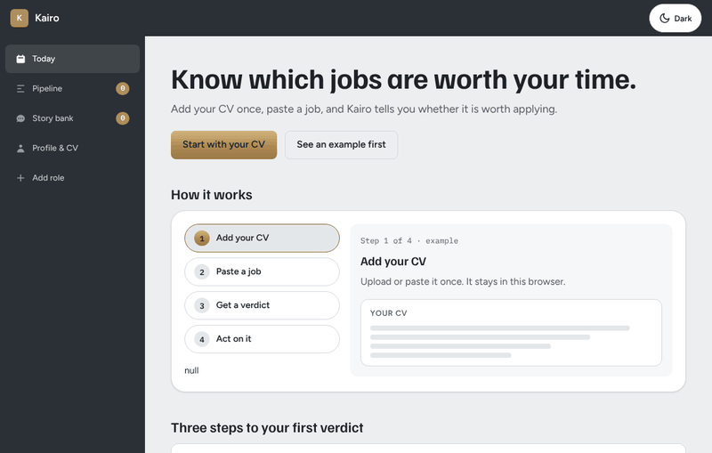

The first-run flow above (about 15 seconds, made-up data only). Every screen works on a phone and on a desktop, in light and dark.

| | Light | Dark |
|---|---|---|
| **Today** (desktop) | 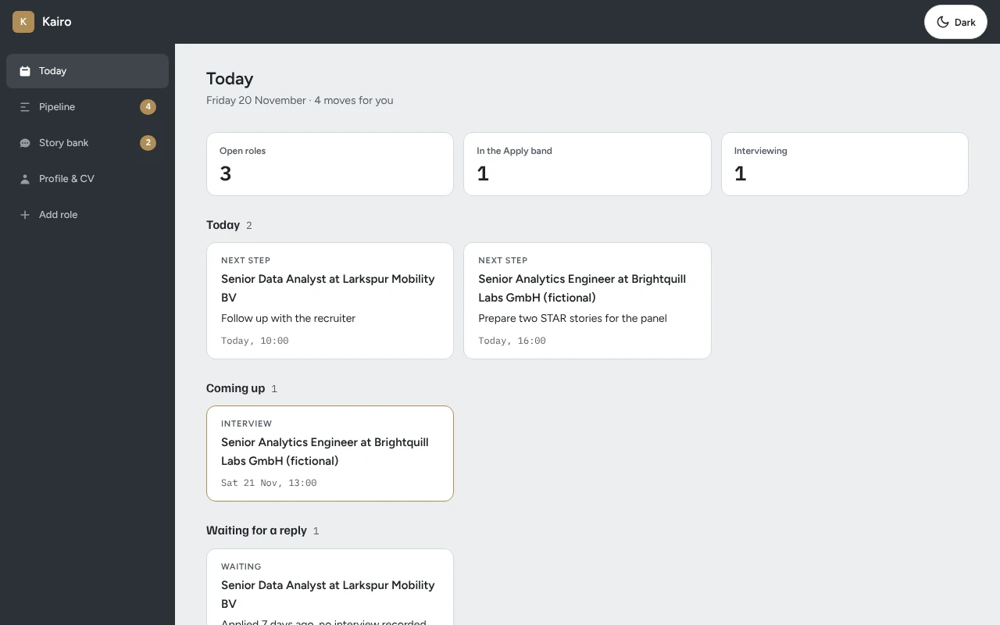 | 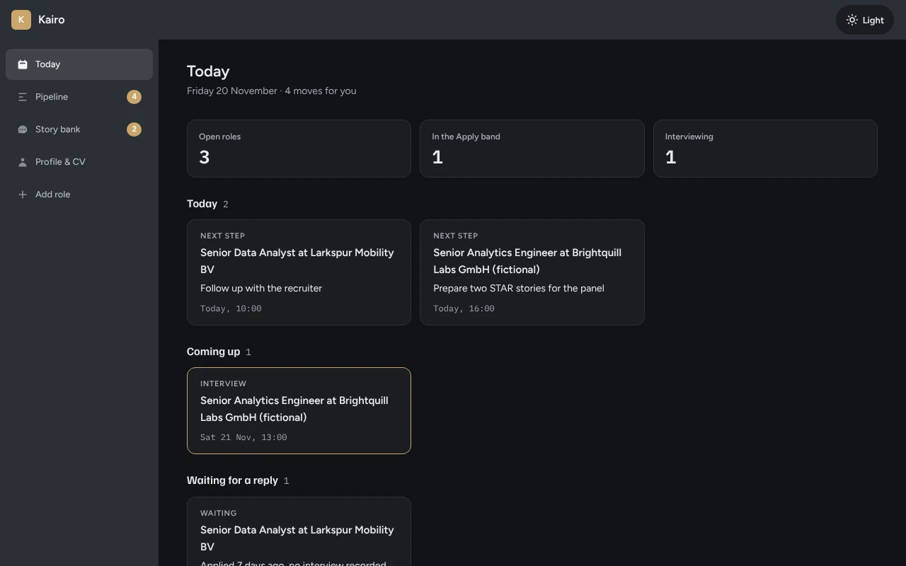 |
| **Role workspace** (desktop) | 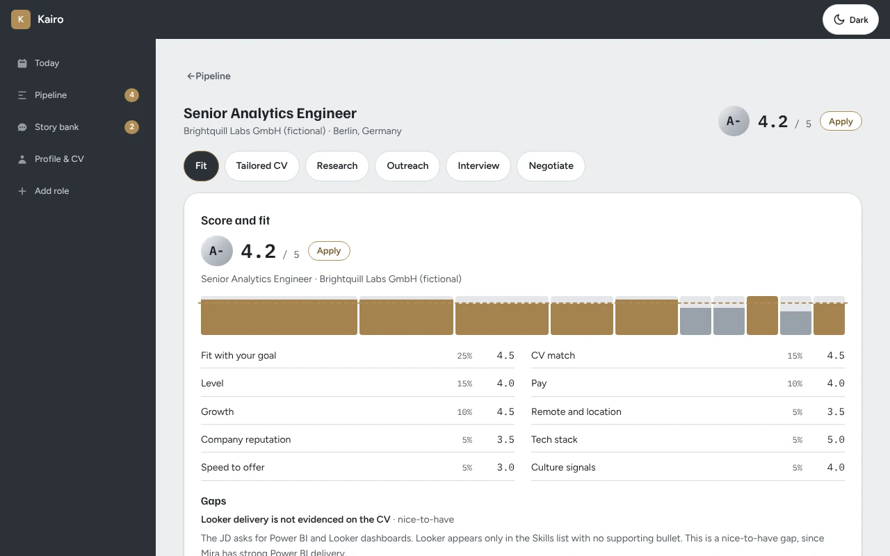 | 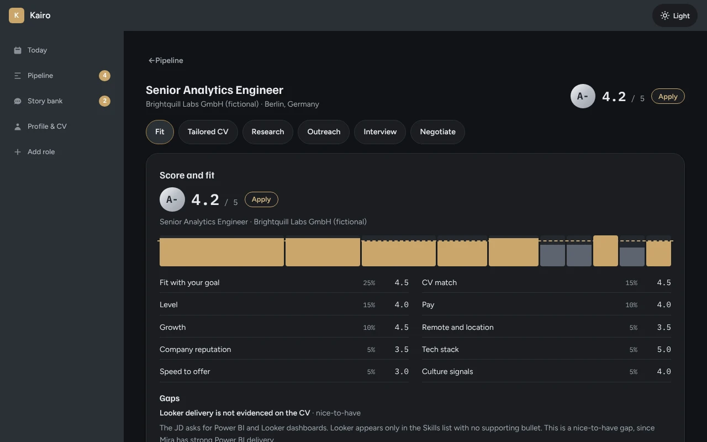 |
| **Home** (desktop) | 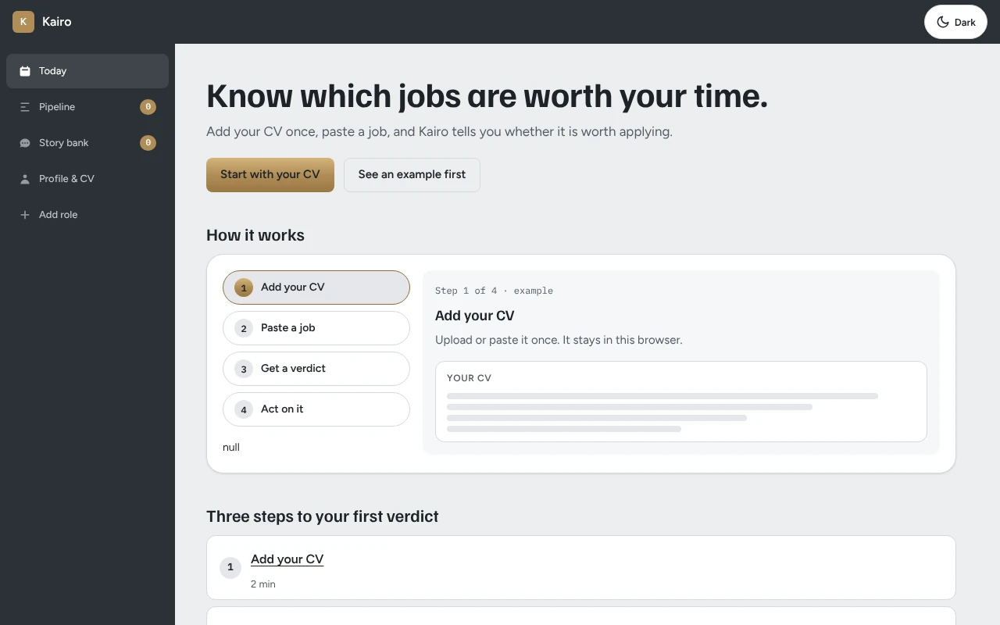 | 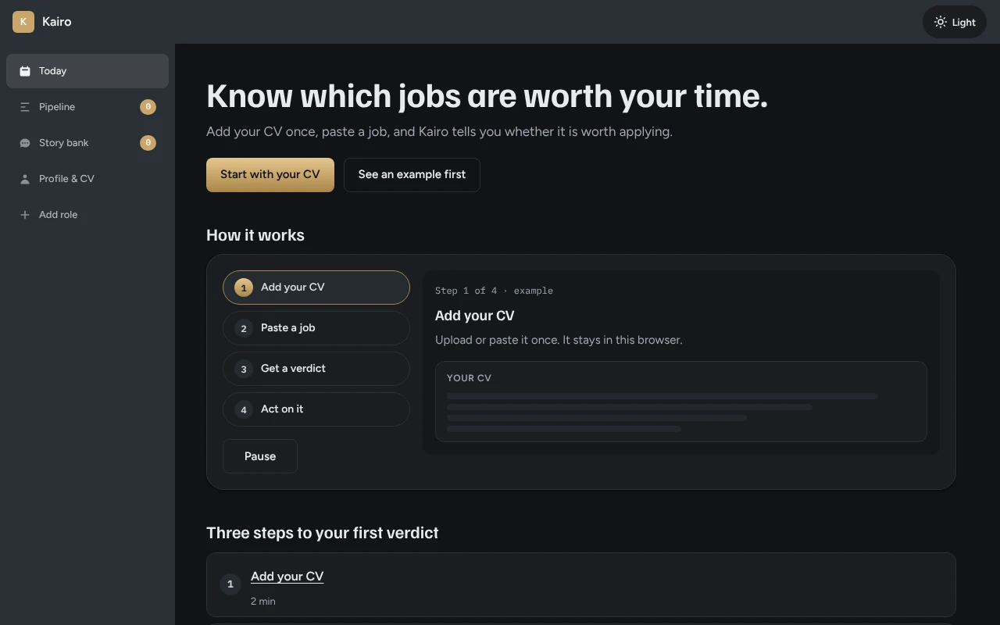 |

| Phone | Light | Dark |
|---|---|---|
| **Today** | 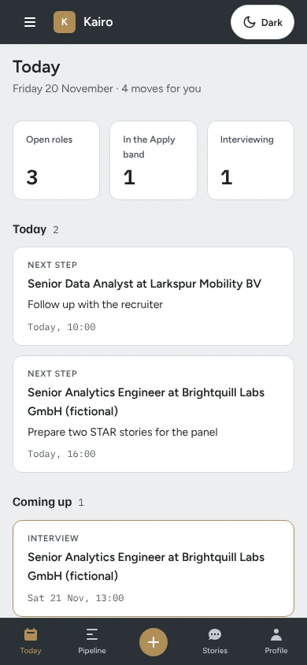 | 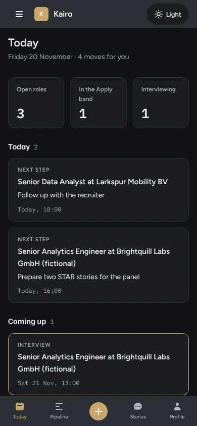 |
| **Role** | 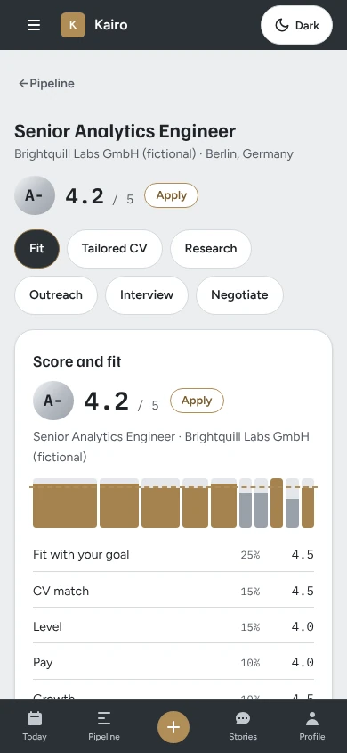 | 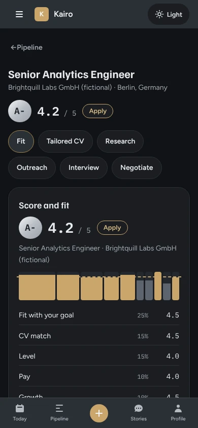 |
| **Home** | 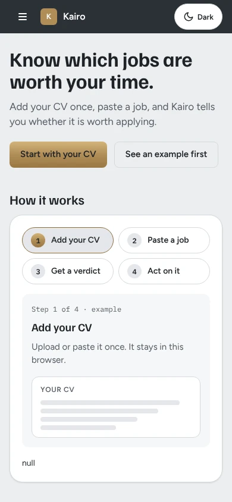 | 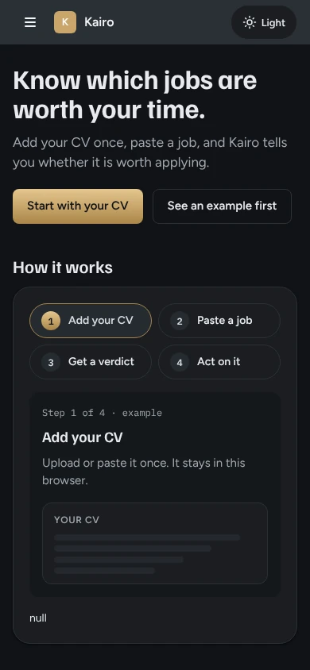 |

All images are generated from a fictional profile (`tests/fixtures/synthetic-profile.json`) and a mocked API by `node scripts/screenshots/capture.mjs` (needs `npm ci`, a Playwright chromium, `ffmpeg` and Python with Pillow). They contain no real person, CV or company.

## Features

| Mode | What it does |
|---|---|
| `evaluate` | Archetype-first evaluation (blocks A-F), scored on 10 weighted dimensions computed server-side, with a letter grade, salary benchmark by job location, personalization hooks, STAR story starters, and named gaps with a bridging narrative. |
| `pdf` | Rewrites your CV tailored to a specific JD — keyword injection, bullet reframing, no invented experience, every original role preserved. |
| `research` | Company research brief: stage, funding, headcount, culture, interview process, red flags, comp, verdict. |
| `negotiate` | A negotiation script — opening, anchor, fallback, close — plus a ready-to-send email. |
| `story` | Generates a STAR-format interview answer from a prompt and your CV. |
| `scan` | Suggests realistic open roles matching a focus area. |
| `contacto` | LinkedIn connection note + InMail draft for outreach. |

All seven modes are driven by **one serverless function** (`api/evaluate.js`); the frontend just changes the `mode` field. Screens call it only through `runTool()` in `public/js/api.js`.

## Screens

| Route | Screen |
|---|---|
| `#/home` | First-run welcome: what Kairo does, an example result, a four-step demo, backup and restore. |
| `#/today` | The next moves across your roles, grouped by time. |
| `#/pipeline`, `#/pipeline/:id` | Your saved roles by stage, with a detail panel. |
| `#/role/:id/:tab` | One role: Fit, Tailored CV, Research, Outreach, Interview, Negotiate. |
| `#/stories` | Story bank (STAR answers). |
| `#/profile` | Profile and CV text (paste or upload a PDF), theme, storage use. |
| `#/add`, `#/add/several`, `#/add/scan` | Add one job description, several at once, or find roles (paused). |

## Stack

- **Frontend:** a static single-page app (`public/index.html` plus ES modules, vanilla JS, no build step): a shell with a hash router, seven views (Home, Today, Pipeline, Role, Stories, Profile, Add role), a small UI kit, and a Light / Dark theme. PDF.js (served locally) extracts CV text. See [docs/ARCHITECTURE.md](docs/ARCHITECTURE.md).
- **Backend:** one Vercel serverless function, `api/evaluate.js`, calling the Anthropic Claude API.
- **Persistence:** `localStorage` in the browser (schema v2, additive only) — no database. Fonts and PDF.js are self-hosted: no third-party requests on page load.
- **Model:** `claude-sonnet-5-5` (see [Model updates](#model-updates) below).

## Setup

### Prerequisites
- Node.js ≥ 20
- [Vercel CLI](https://vercel.com/docs/cli) (`npm i -g vercel`) for local dev and deploys
- An [Anthropic API key](https://console.anthropic.com/settings/keys)

### Local development

```bash
git clone https://github.com/kishanbala/kairo.git
cd kairo
npm install
cp .env.example .env.local   # fill in ANTHROPIC_API_KEY
vercel dev                   # serves on http://localhost:3000
# Run `vercel dev` directly, not via an npm script — Vercel CLI auto-detects a
# package.json "dev" script and would try to run itself recursively.
```

### Deploy

```bash
npm run deploy                # runs `vercel --prod`
```

In the Vercel dashboard, set `ANTHROPIC_API_KEY` under **Project Settings → Environment Variables** (Production, and Preview if you want preview deployments to work).

## API contract

`POST /api/evaluate`

```json
{
  "mode": "evaluate",        // one of: evaluate | pdf | research | negotiate | story | scan | contacto
  "content": "string",       // required — job description, research target, prompt, etc.
  "cv": "string",            // optional — appended as candidate CV context
  "profile": {                // optional — appended as candidate context if `name` is set
    "name": "string",
    "target": "string",
    "salary": "string",
    "location": "string",
    "story": "string"
  }
}
```

Response:
```json
{ "success": true, "data": { /* mode-specific JSON */ }, "mode": "evaluate" }
```
If the model's output isn't valid JSON, `data` falls back to `{ "raw": "<model text>" }` rather than erroring — the request still returns `200`.

Errors: `400` (no/invalid content), `413` (content over 50,000 characters), `405` (non-POST), `500` (missing API key, or the upstream Claude API call failed — see `message` for details).

## Testing

```bash
npm test
```

Checks that `lib/prompts.generated.js` is in sync with `prompts/*.md`, then runs every `tests/*.test.js` on Node's built-in test runner (`node:test`) — no test framework dependency. Browser tests (shell, every view in three viewports and both themes, accessibility, GDPR, pixel checks) live in `e2e/` and run with `npx playwright test` against a local static server and mocked API; see [docs/ARCHITECTURE.md](docs/ARCHITECTURE.md#tests). The Anthropic SDK is mocked via `require.cache`, so the suite makes zero real API calls and costs nothing to run. It covers:

- Transport: CORS headers, `OPTIONS`/method handling, missing/invalid/oversized `content`
- The retired-model regression this fix addressed (asserts the exact model ID sent, and that it's never the old one)
- All 7 modes individually, including that each selects its own system prompt
- `cv` / `profile` context injection into the prompt
- Response parsing: leading `thinking` blocks, markdown-fenced JSON, non-JSON fallback, empty model output
- Upstream API failures surfacing as `500` with the underlying message, CORS headers included
- Prompt layer (`tests/prompts.test.js`): generated file in sync, attribution headers present, every mode's JSON schema parses, the `evaluate` schema keeps every field the frontend reads, the `pdf` hard rules and `scan` no-fabrication rules can't be edited away unnoticed
- Scoring (`tests/scoring.test.js`, `tests/evaluate-scoring.test.js`): upstream weights, grade boundaries, legacy-dimension mapping, truncated-output flag

## Prompt architecture

The model-facing logic is adapted from [santifer/career-ops](https://github.com/santifer/career-ops): a shared rule set plus one prompt per mode, an archetype-first evaluation, and a 10-dimension weighted score. See [docs/COMPARISON.md](docs/COMPARISON.md) for exactly what is shared, what differs, and where this project diverges from upstream today, and [docs/ARCHITECTURE.md](docs/ARCHITECTURE.md) for the mapping and backlog.

- Edit prompts in `prompts/*.md`, then run `npm run build:prompts` (`npm test` fails if you forget).
- `prompts/modes.json` maps each mode to its parts and to the upstream `modes/` files it derives from.
- `npm run upstream:check` reports upstream prompt changes and names the local prompt files to review; `npm run upstream:accept` records a new baseline after you've reviewed them.
- Scoring is computed by the server (`lib/scoring.js`) from the model's 10 dimension scores, not by the model.

## Model updates

The model ID lives in one place — `MODEL` in `api/evaluate.js`. Anthropic retires model snapshots on a published schedule; when `claude-sonnet-5-5` is deprecated, check the [model deprecations page](https://platform.claude.com/docs/en/about-claude/model-deprecations) for the replacement, update `MODEL`, and re-run `npm test` plus a manual check against each of the 7 modes before deploying.

## Known limitations

- `Access-Control-Allow-Origin: *` — the API accepts requests from any origin. Acceptable for a single-user personal tool; would need an origin allowlist or auth before sharing more broadly.
- No auth — anyone with the URL can call the API and spend your Anthropic credits. The 50,000-character content cap limits damage per request but doesn't rate-limit.
- `vercel.json` sets `maxDuration: 60` for the API function. **This requires a Vercel Pro plan** — on the Hobby plan, functions are capped at 10s regardless of this setting, which can cause timeouts on longer CV rewrites. Either upgrade the plan or lower expectations for `pdf`/`evaluate` mode on Hobby.
- No database — all evaluation history lives in the browser's `localStorage` and doesn't sync across devices. Use Export backup on Home to move it.
- Some actions are paused behind feature flags (`public/js/features.js`): scanning for roles, the CV archetype choice, the full CV preview and deleting a role. They stay visible with a "Being rebuilt" note.

## Roadmap

- Phase 2: remaining CV/UX polish
- Phase 3: migrate `localStorage` to Supabase (deferred until it's a real blocker)

## Contributing / history

This is a solo personal project; see [CHANGELOG.md](CHANGELOG.md) for what's changed and [SECURITY.md](SECURITY.md) for how API keys and request limits are handled. CI (`.github/workflows/ci.yml`) runs the test suite on every push and PR to `main`.

## Credits and relationship to upstream

Derived in part from [career-ops](https://github.com/santifer/career-ops) by [Santiago Fernández de Valderrama](https://github.com/santifer), MIT licensed: the evaluation architecture, archetypes, scoring weights and prompt rules come from there (see [THIRD_PARTY_NOTICES.md](THIRD_PARTY_NOTICES.md)). This repository is an independent project, not a GitHub fork, and is **not affiliated with or endorsed by** the upstream project or its maintainer.

Upstream is a local-first toolkit that an AI coding CLI runs against files on your machine (it also has an experimental local web UI). This project is a hosted web app: a static frontend and one serverless function, a fixed Claude model, browser `localStorage` instead of files, seven modes instead of upstream's wider set, and server-side scoring. [docs/COMPARISON.md](docs/COMPARISON.md) has the side-by-side, the list of known divergences, and what is not ported.

## License

MIT — see [LICENSE](LICENSE).
See also [THIRD_PARTY_NOTICES.md](THIRD_PARTY_NOTICES.md).
